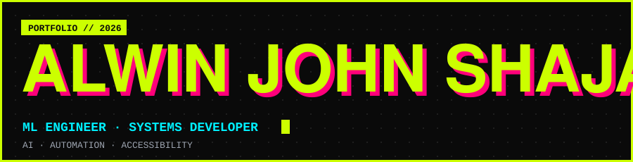

  

  

<h3 align="center">BUILDING INTELLIGENT AGENTS AND ACCESSIBLE SOFTWARE.</h3>

  I build projects around AI, hands-free automation, real-time computer vision 
  and machine learning systems, and sharpen my DSA and problem solving along the way.

  

---

| DEGREE | PRIMARY STACK | FOCUS | BASED IN |
|:---:|:---:|:---:|:---:|
| B.Tech CSE (2023–2027) | Python · C++ · Java · SQL | AI · Automation · Accessibility | Thrissur, Kerala |

---

## FEATURED PROJECTS

<table>
  <tr>
    <td width="33%" valign="top">
      <h3>🎙️ <a href="https://github.com/AlwinJCOde667/PROJECT-CERP-y">CERP-y</a></h3>
      Voice-activated computer automation that helps users with motor disabilities operate their computers hands-free.  
        
    </td>
    <td width="33%" valign="top">
      <h3>🛡️ <a href="https://github.com/AlwinJCOde667/AI-Based-Fraud-and-Trust-Detector-in-E-Commerce-Platforms">AI Fraud & Trust Detector</a></h3>
      Machine learning system that scores trust and flags fraud on e-commerce platforms to protect buyers from fraudulent sellers.  
        
    </td>
    <td width="33%" valign="top">
      <h3>🎭 <a href="https://github.com/alwin-mj/Procedural-Narrative-Engine">Procedural Narrative Engine</a></h3>
      Real-time facial emotion detection that drives scene direction in an interactive story, reacting live to viewer emotions.  
        
    </td>
  </tr>
</table>

---

## TECH STACK

  
  
  
  
  
  
  
  
  

---

## NOW

| | |
|---|---|
| **LEARNING** | Data structures and algorithms in C++, Java and Python, plus OOP and problem solving |
| **BUILDING** | Projects in voice automation, machine learning and computer vision |

---

## EDUCATION

- **B.Tech, Computer Science and Engineering**: Sahrdaya College of Engineering and Technology (2023–2027)
- **Class XII and X (CBSE)**: Rajagiri Christu Jayanthi Public School, Kakkanad

## CERTIFICATIONS

- ✅ **Advanced C++ and Git Training**: EduPyramids, SINE, IIT Bombay
- ✅ **Web Development Fundamentals**: IBM SkillsBuild (Edunet)
- ✅ **AI for Entrepreneurship**: Intel (2025)
- ✅ **Ethics and Risk Management Contest**: IEEE Region 10

---

## CONTACT

  
  
  

